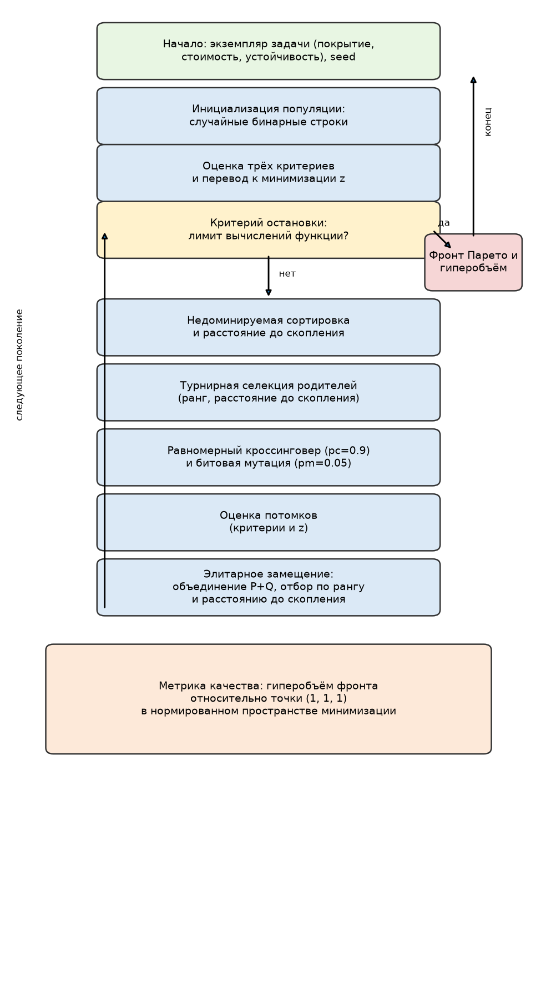
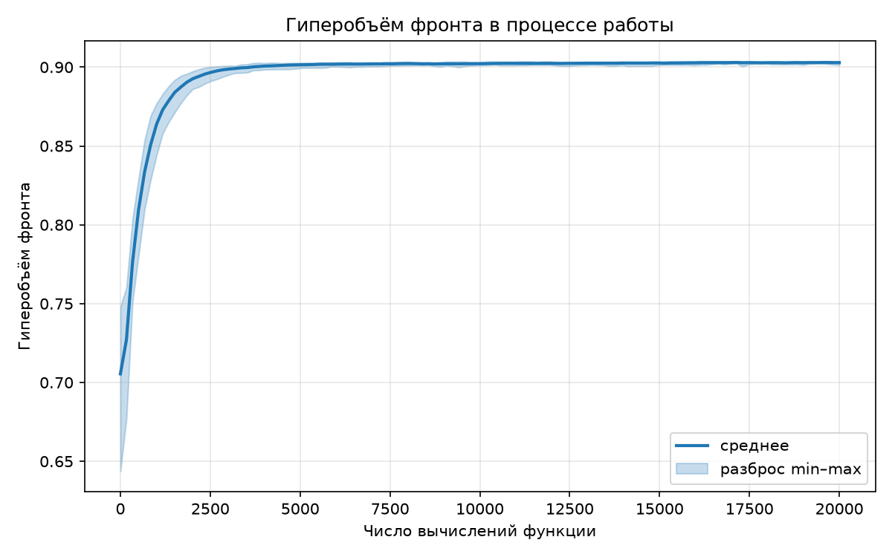
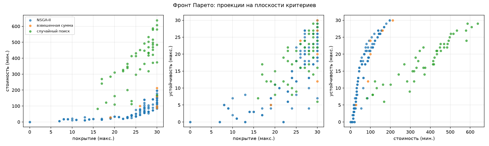
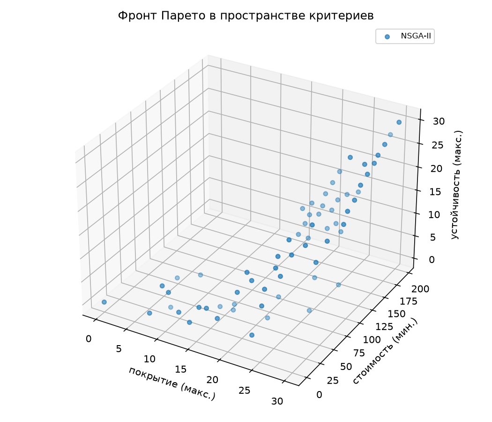
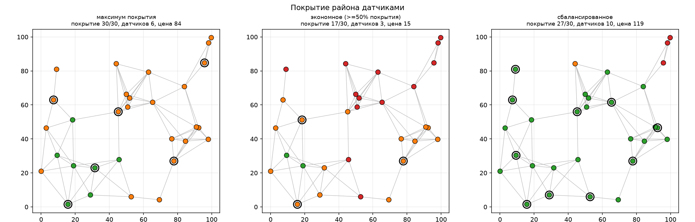
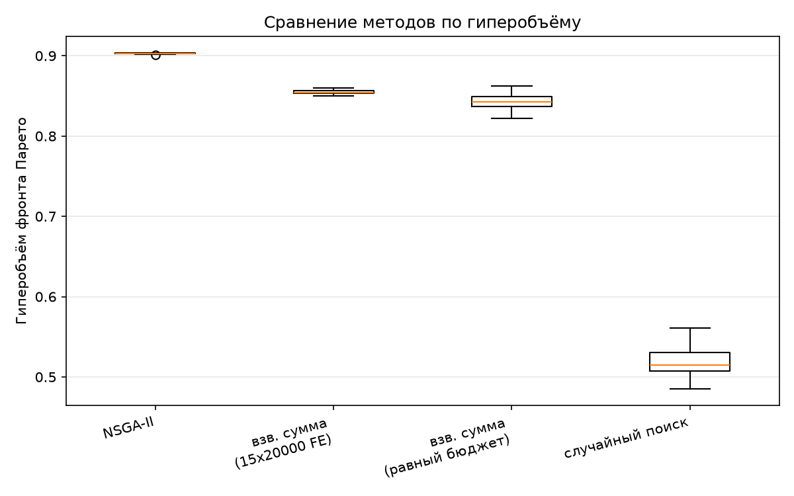

# Отчёт по лабораторной работе № 3

## Многокритериальная эволюционная оптимизация (трек A)

Дисциплина «Эволюционное программирование и генетические алгоритмы».

---

## 1. Постановка задачи и индивидуальный вариант

**Вариант 9** (`V = 9`, `N = 15`, `Q = 1`, `Y = 26`), **трек A**:
**размещение датчиков на графе**.

Дан неориентированный граф района из `n` вершин (потенциальные места
установки). Датчик в вершине покрывает саму вершину и всех её соседей;
каждый датчик имеет стоимость установки. Требуется выбрать подмножество
вершин `x ∈ {0,1}^n`, достигая трёх конфликтующих целей:

$$f_1(x) = \sum_v \mathrm{covered}_v(x) \to \max \text{ (покрытие)},$$
$$f_2(x) = \sum_i c_i x_i \to \min \text{ (стоимость)},$$
$$f_3(x) = \sum_v \mathrm{double}_v(x) \to \min \text{ (неустойчивость)},$$

где `covered_v(x) = 1`, если вершина `v` покрыта хотя бы одним датчиком,
а `double_v(x) = 1`, если вершина `v` НЕ покрыта дважды (т.е. теряет
покрытие при отказе одного датчика). Третий критерий минимизируется:
`f_3 = n − robustness`, где `robustness` — число вершин, сохраняющих
покрытие при отказе любого одного датчика («максимум устойчивости
к отказу» в терминах варианта).

**Конфликт критериев** принципиален: каждый новый датчик растит покрытие,
но одновременно увеличивает стоимость; устойчивость требует избыточности
(перекрытия зон покрытия), то есть ещё больших затрат. Не существует
решения, одновременно наилучшего по всем трём критериям: решение «датчик
в каждой вершине» максимизирует покрытие и устойчивость, но максимизирует
и стоимость; пустое решение бесплатно, но ничего не покрывает. Поэтому
целью оптимизации является не одно решение, а **фронт Парето** — множество
недоминируемых компромиссов.

Жёстких ограничений нет: любое подмножество вершин допустимо, поэтому
предметом оптимизации является исключительно компромисс между критериями.

## 2. Формальное описание пространства решений и критериев

- **Пространство решений:** `D = {0,1}^n` — характеристические векторы
  подмножеств вершин (`n = 30`).
- **Критерии:** `f1 (максимум), f2 (минимум), f3 (минимум)`; покрытие и
  устойчивость неаддитивны (зависят от перекрытия зон), стоимость
  аддитивна.
- **Доминирование Парето** (в задаче минимизации): решение `x` доминирует `y`,
  если `f_k(x) ≤ f_k(y)` для всех `k` и хотя бы для одного критерия выполнено
  строгое неравенство. Для единообразия вводится вектор потерь
  `z(x) = (1 − f1(x)/n, f2(x)/C, f3(x)/n)` (минимизация), где
  `C` — суммарная стоимость всех датчиков.
- **Фронт Парето:** множество решений, не доминируемых никаким другим.
- **Метрика качества фронта:** гиперобъём (hypervolume) — объём области в
  пространстве нормированных критериев, доминируемой множеством решений
  относительно опорной точки `(1, 1, 1)`. Чем больше гиперобъём, тем ближе
  фронт к идеалу и чем он шире, тем лучше представлен компромисс.

## 3. Представление особи

- **Генотип:** бинарная строка длины `n = 30`; `x_i = 1` означает, что
  датчик установлен в вершине `i`.
- **Фенотип:** множество вершин с датчиками; покрытие вычисляется обходом
  окрестностей датчиков, стоимость — суммированием, устойчивость —
  подсчётом вершин с кратностью покрытия не менее двух.
- **Приспособленность:** векторная — особь оценивается тройкой `(f1, f2, f3)`;
  скаляризация отсутствует, сравнение идёт по доминированию Парето.

## 4. Описание алгоритма: NSGA-II

Реализован алгоритм NSGA-II (`nsga2.py`) — полностью самостоятельно,
без использования готовых реализаций.

**Параметры базовой конфигурации:**

| Параметр | Значение |
| --- | --- |
| Размер популяции | 100 |
| Бюджет вычислений функции | 20 000 |
| Вероятность кроссинговера | 0.9 |
| Вероятность мутации на бит | 0.05 |
| Кроссовер | равномерный |
| Селекция родителей | турнирная (k = 2) по (ранг, −расстояние до скопления) |
| Замещение | элитарное: объединение родителей и потомков |
| Критерий остановки | лимит вычислений функции (20 000) |
| Число запусков в серии | 21 (seed 0, 1, …, 20) |

**Ключевые механизмы:**

1. **Быстрая недоминируемая сортировка** (`fast_non_dominated_sort`):
   для каждой точки вычисляется число доминирующих её точек (через
   векторизованную матрицу доминирования), после чего точки
   последовательно распределяются по фронтам. Точки фронта 0 не доминируются
   никем — это текущий фронт Парето.
2. **Расстояние до скопления** (`crowding_distance`) — мера того, насколько
   точка изолирована от соседей по каждому критерию; граничные точки фронта
   получают бесконечное расстояние. Используется и при отборе родителей
   (при равных рангах предпочтение отдаётся более изолированным точкам), и
   при замещении: если фронт не помещается в новое поколение целиком, берутся
   точки с наибольшим расстоянием до скопления.
3. **Элитарное замещение:** новое поколение формируется из объединения
   родителей и потомков путём отбора по рангу, а при переполнении фронта —
   по расстоянию до скопления. Это гарантирует, что хорошие решения не
   теряются, а разнообразие внутри фронтов поддерживается.
4. **Операторы вариации:** равномерный кроссинговер (с вероятностью 0.9) и
   битовая мутация (с вероятностью 0.05 на бит) — стандартные бинарные
   операторы, корректные для используемого представления.

**Блок-схема алгоритма** — `results/flowchart.png`:

**Новые механизмы по сравнению с работами № 1–№ 2:** недоминируемая
сортировка, расстояние до скопления и векторная (многокритериальная)
приспособленность — в ЛР № 1–№ 2 применялась только скалярная
приспособленность и одиночный отбор по ней.

## 5. Результаты серии независимых запусков

Серия из 21 запуска NSGA-II при бюджете 20 000 вычислений функции
(`results/runs_nsga2.csv`, `results/history_nsga2.csv`).
Метрика — гиперобъём фронта Парето (точный, 3D, опорная точка `(1, 1, 1)`
в нормированном пространстве):

| Характеристика | Значение |
| --- | --- |
| Лучший гиперобъём | 0.9035 |
| Средний гиперобъём | 0.9029 |
| Медиана | 0.9030 |
| Стандартное отклонение | 0.0005 |
| Худший гиперобъём | 0.9015 |
| Средний размер фронта | 100.0 (вся популяция) |
| Среднее время запуска | 0.83 с |

Алгоритм крайне устойчив: разброс гиперобъёма по серии составил всего
0.0005 (0.06 % от среднего), а число точек в фронте во всех запусках равно
размеру популяции — почти все особи финальной популяции недоминируемы, что
естественно для задачи с тремя критериями и 30 битами: большинство
подмножеств вершин несравнимы по Парето. Динамика гиперобъёма
(среднее и разброс по сериям) — `results/hv_convergence.png`: быстрый
рост на первых ~3000 вычислений и плавная сходимость к 0.90.

## 6. Визуализация фронта Парето

Поскольку критериев три, построены:

- три 2D-проекции фронта на плоскости (покрытие–стоимость,
  покрытие–устойчивость, стоимость–устойчивость) с наложением фронтов
  NSGA-II, взвешенной суммы и случайного
  поиска — `results/pareto_projections.png`;
- диаграмма фронта в трёхмерном пространстве критериев —
  `results/pareto_3d.png`;
- карта покрытия для трёх характерных решений (вершины по кратности
  покрытия, датчики обведены) — `results/coverage_map.png`;
- таблица всех точек фронта (критерии, число датчиков, списки датчиков) —
  `results/nsga2_fronts.csv`.

## 7. Три характерных решения из фронта

Выбраны три решения из фронта репрезентативного запуска (seed 0),
иллюстрирующие разные стратегии размещения датчиков
(`results/representative_solutions.csv`):

| Решение | Покрытие | Стоимость | Устойчивость | Датчиков | покрытие/ед. стоимости |
| --- | ---: | ---: | ---: | ---: | ---: |
| **Максимум покрытия** | 30/30 | 84 | 7 | 6 | 0.36 |
| **Экономное** (≥ 50 % покрытия) | 17/30 | 15 | 2 | 3 | 1.13 |
| **Сбалансированное** | 27/30 | 119 | 26 | 10 | 0.23 |

Предметная трактовка:

- **«Максимум покрытия»** — полное покрытие района: 6 датчиков покрывают
  все 30 вершин за 84 единицы стоимости. Устойчивость при этом лишь 7:
  большинство вершин покрыто ровно один раз, и отказ одного датчика
  оголяет значительную часть района. Это решение доминирует все остальные
  по покрытию, но уязвимо к отказам.
- **«Экономное»** — всего 3 датчика за 15 единиц стоимости покрывают
  17 вершин (57 % района) с эффективностью 1.13 вершины на единицу
  стоимости — втрое выше, чем у «максимума». Устойчивость минимальна (2):
  типичный бюджетный вариант — «покрыть побольше задешево», пригодный
  для некритичного мониторинга.
- **«Сбалансированное»** — ближайшая к идеальной точке (максимум покрытия,
  минимум стоимости, максимум устойчивости) точка фронта в нормированном
  пространстве критериев: 10 датчиков, покрытие 27/30 (90 %) при
  устойчивости 26 — почти каждая покрытая вершина имеет дубль. Цена —
  119 единиц стоимости: надёжность обходится дороже всего.

Все три решения недоминируемы: «улучшение» любого из них по одному критерию
неминуемо ухудшает хотя бы один другой.

## 8. Сравнение с подходом взвешенной суммы

Подход взвешенной суммы скаляризует задачу:
`s(x) = w₁·f₁н − w₂·f₂н + w₃·f₃н → max` (нормированные критерии; плюс
перед устойчивостью, так как она максимизируется), и решает
обыкновенную задачу максимизации одним ГА. Для построения фронта
использовалась сетка из 15 весовых векторов (шаг 0.25 по симплексу).

Сравнение методов при одинаковом лимите вычислений функции
(`results/methods_compare.csv`, `results/hv_comparison.png`):

| Метод | Бюджет (FE) | HV лучший | HV средний | HV медиана | HV стд. | Размер фронта |
| --- | ---: | ---: | ---: | ---: | ---: | ---: |
| **NSGA-II** | 20 000 | **0.9035** | **0.9029** | **0.9030** | **0.0005** | 100.0 |
| Взв. сумма (15 запусков) | 15 × 20 000 = 300 000 | 0.8595 | 0.8544 | 0.8545 | 0.0024 | 7.4 |
| Взв. сумма (равный бюджет) | 15 × 1 333 = 19 995 ≈ 20 000 | 0.8620 | 0.8422 | 0.8428 | 0.0095 | 7.3 |
| Случайный поиск | 20 000 | 0.5607 | 0.5155 | 0.5150 | 0.0203 | 42.6 |

Наблюдения:

- **NSGA-II превосходит взвешенную сумму** по гиперобъёму на 6 %
  (0.9029 против 0.8544) — и это при том, что подходу взвешенной суммы
  отвели в 15 раз больший суммарный бюджет (300 000 против 20 000
  вычислений функции). При равном суммарном бюджете отрыв — 7 %
  (0.9029 против 0.8422).
- **Фронт взвешенной суммы беднее**: 7–8 точек против 100 у NSGA-II.
  Каждый запуск взвешенной суммы находит ровно одно решение, и объединение
  15 оптимумов даёт лишь узкий срез компромиссов.
- **Случайный поиск** даёт фронт из ~43 точек, но с гиперобъёмом всего
  0.5155 — в 1.75 раза хуже NSGA-II: без отбора и адаптации точки фронта
  оказываются далеко от идеальной области.

### Почему сравнение со взвешенной суммой ограничено

Метод взвешенной суммы принципиально находит только **поддерживаемые**
решения — те, в которых достигается максимум некоторой линейной свёртки
критериев. Если фронт Парето невыпуклый (а для дискретной задачи размещения
датчиков это типично из-за сетевого эффекта перекрытий), часть
недоминируемых точек не является максимумом ни одной свёртки и не может
быть найдена методом взвешенной суммы ни при каких весах.

Количественная оценка (`results/supported_analysis.csv`): из 65 точек фронта
(после дедупликации одинаковых целевых векторов) только **25 являются
поддерживаемыми** — 62 % компромиссов принципиально недостижимы для метода
взвешенной суммы. Это хорошо видно на проекциях фронта
(`results/pareto_projections.png`): точки взвешенной суммы тяготеют
к краям («только покрытие», «только стоимость»), тогда как NSGA-II
равномерно покрывает всю поверхность компромиссов.

## 9. Выводы

**Сравнительная эффективность.** NSGA-II — наиболее эффективный из
исследованных методов: при одинаковом бюджете он строит фронт в 13 раз
большего размера с гиперобъёмом на 7 % выше, чем у взвешенной суммы, и
в 1.75 раза превышающим случайный поиск. Высокая устойчивость (отклонение
0.06 % по серии из 21 запуска) объясняется элитарным замещением и
поддержанием разнообразия через расстояние до скопления.

**Структура компромиссов.** Анализ фронта показывает, что дешёвое покрытие
возможно (3 датчика — 57 % района за 15 единиц), но надёжность стоит
дорого: подъём устойчивости с 7 до 26 требует роста затрат с 84 до 119
при почти том же покрытии. Эффективность (покрытие на единицу стоимости)
максимальна у компактных решений (1.13 у «экономного» против 0.36
у «максимума покрытия») — то есть с точки зрения отдачи на единицу
бюджета выгоднее ставить мало датчиков, а полное и надёжное покрытие
обходится с большой потерей эффективности.

**Почему результат следует считать хорошим.** Алгоритм за 20 000
вычислений функции и менее секунды строит представительный фронт из
100 компромиссных решений, покрывающий весь диапазон от «пустого района»
до «полного покрытия с запасом», и делает это устойчиво по серии
запусков. Альтернатива — метод взвешенной суммы — даже при 15-кратном
бюджете находит лишь 38 % этих компромиссов.

**Ограничения и направления улучшения.** Размер фронта равен размеру
популяции (почти все особи недоминируемы), что снижает информативность
ранжирования внутри фронта; более крупные популяции и большее число
поколений увеличат разрешение фронта. Полезным расширением было бы
добавление жёстких ограничений (бюджет проекта, обязательные позиции
датчиков, зоны с запретом установки) с их учётом через ограниченное
доминирование, а также использование внешнего архива недоминируемых
решения для агрегации результатов нескольких запусков.

## 10. Воспроизводимость

- Используются `numpy` (численные вычисления) и `matplotlib` (графики);
  готовых реализаций NSGA-II и метрик многокритериальной оптимизации нет.
- Экземпляр задачи генерируется детерминированно (`seed = 11`), сохраняется
  в `data/nodes.csv` и `data/instance.json`.
- Каждый запуск алгоритма однозначно определяется параметром `--seed`;
  повторные запуски дают идентичные значения гиперобъёма и фронты.
- Команды запуска — `README.md`; таблица параметров экспериментов —
  `results/params.csv`.
